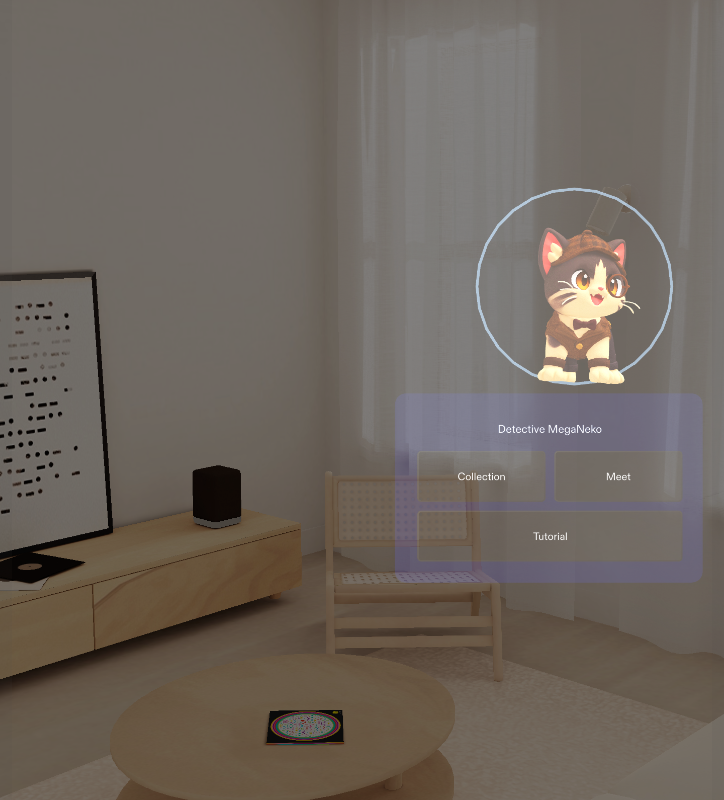

# MEGANEKO / メガネコ

**Meet, shake hands, and discover your next companion.**

MegaNeko is a social AR companion game for SPECS. Each player has a glasses-wearing cat companion. The idea is simple: meet someone with the same kind of cat, agree to fuse, and greet each other with a handshake. Each participant receives an independently drawn new companion. Collect familiar faces and discover rare cats through new encounters.

The characters take inspiration from the gentlemen and ladies of Victorian London. This hackathon edition features **Gentle, Detective, Princess, and Queen MegaNeko**, with more characters planned.

## Download the project

Choose **Code → Download ZIP**, extract the download, and open **MEGANEKO.esproj** in **Lens Studio 5.23.2**. This repository contains the project, scripts, character assets, and a guided tutorial. It is not a browser-playable game.

## Why I made it

After trying a shared AR experience at AWE during a stay in the United States and meeting people from Snap, I wanted to create a reason to go outside and meet people through AR. I also run a VR community of about 1,600 members, where collecting and combining characters has helped spark conversations and repeat visits. MegaNeko brings those ideas together: a companion for your walk, and a natural reason to say hello.

## Made with

Lens Studio, Codex with CLAD, Blender, and Tripo AI. Tripo AI was used for character generation; some attempts produced incorrect front/back geometry and textures, so the hackathon cast was narrowed to four usable characters. The project has been tested in Lens Studio Preview; physical-device testing remains to be completed.

A four-character social AR companion prototype for **Learn AR with SPECS**.

Built with Lens Studio 5.23.2, CLAD and Codex. Character assets were supplied by the creator and adjusted/rigged in Blender. This folder contains the Lens Studio project and its `devpost/` design and verification documents.

## Open and try

1. Open `MEGANEKO.esproj` in Lens Studio 5.23.2 or a compatible version.
2. Start Preview. Your companion appears directly; there is no Solo/Multiplayer mode-selection screen.
3. **Collection** opens the four-character collection. **Back** returns to your companion.
4. The encounter action guides an intentional connection with another participant. **Fuse** is shown when a valid matching companion is available; consent and greeting prompts appear only when needed.
5. After both participants agree and the greeting conditions are met, the cats fuse and reveal the new companions. Sound starts muted.

### Guided tutorial

Choose **Tutorial** from Home to watch a glasses-wearing virtual partner and a modeled first-person right hand demonstrate a greeting and companion fusion. The scripted sequence runs automatically, with **Exit** during playback and **Replay / Back** at the end. Practice outcomes do not change the real companion, collection, persistent storage or shared-session ledger.

This is a virtual-partner tutorial rendered in Lens Studio Preview. Its modeled handshake is not live hand tracking, a remote human, or evidence of a two-device test. Use that distinction in the submission write-up when recording the tutorial.
### Developer-only Preview demonstration

These keyboard shortcuts remain available in Lens Studio for testing, but are not a visible control grid in the product. Click inside Preview, press **D** for the explicitly labeled simulation, **N** for a matching simulated participant, **F** to request, **F** again to simulate the other person's agreement, and **H** to bring the simulated hands together. **C** opens the collection. Use its visible **Back** button to return.

To repeat a simulated encounter: **H** to separate, **N**, **F**, **F**, **H**. The current and the new cats can be the same; owned species remain eligible.

## Characters

| Character | Rarity | Chance per draw |
|---|---|---:|
| Gentle MegaNeko | Normal | 40% |
| Detective MegaNeko | Normal | 40% |
| Princess MegaNeko | Rare | 18% |
| Queen MegaNeko | Ultra Rare | 2% |

Fusion results are independently drawn for both participants. Duplicate acquisitions improve the collection frame, reaching Gold at five. The four-character edition uses separate storage keys and does not reinterpret or delete earlier prototype collections.

## Models and animation

The four source characters are preserved in the creator's original folder. Processed assets use a 16-bone skeleton and include Idle, Walk and Celebrate clips. Textures are embedded and reduced to 2K for the runtime assets. Source character designs and textures are **not claimed to be CC0**. Third-party packages retain their own licenses; repository visibility is not a blanket redistribution license.

## Verification and limitations

Read the current four-character evidence report in `devpost/` for completed checks. Preview simulation is not proof of real physical hand contact. No real-device test has been performed. Shared mode requires two consenting participants in the same aligned session; automatic city-wide discovery is outside this version.

The public-source package excludes local signing keys, credentials, generated caches and machine-specific workspace settings. Publishing to SPECS requires the publisher's own account and signing setup.

## Design and submission

- `devpost/design-brief.md`: conversation-derived design brief using the official Devpost Learn template, with provenance and unresolved device risks.
- `devpost/play-instructions-ja.txt`: detailed Japanese operation guide.
- `devpost/submission-description.md`: proposed English project description.
- Record a fresh submission video from the current UI. The previously delivered local preview shows an earlier UI and is not the final submission video.

Project: MEGANEKO. Creator: Arata. More companions are planned after the hackathon.

